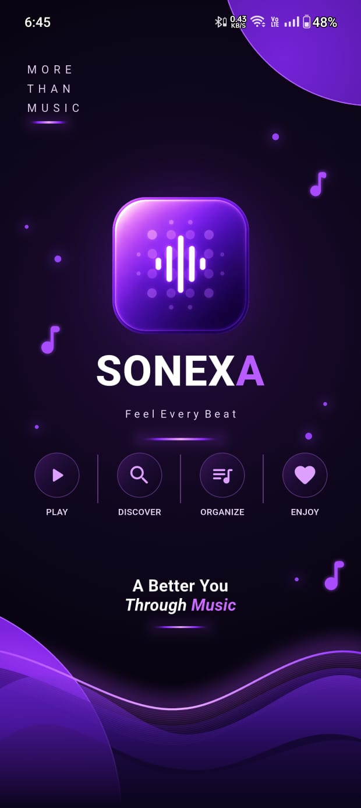
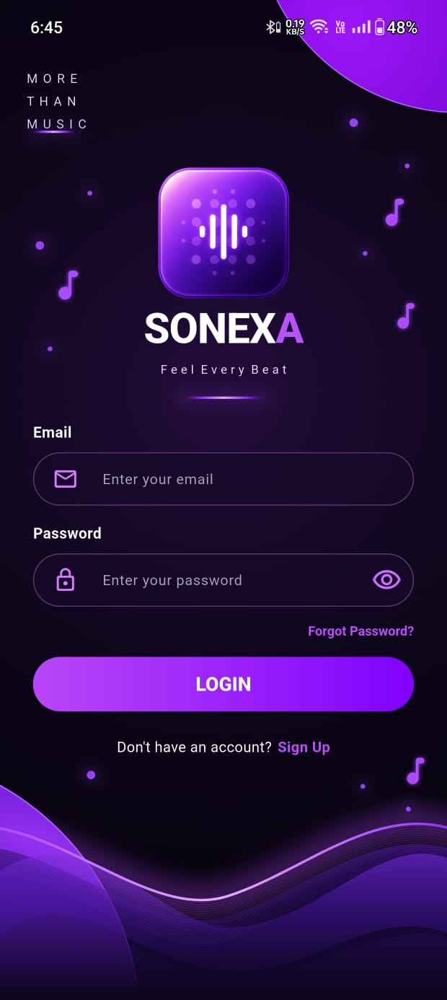
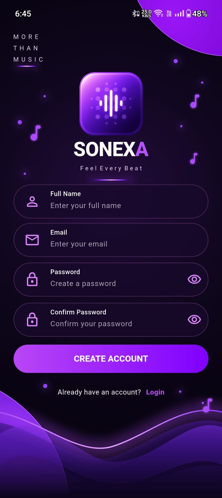
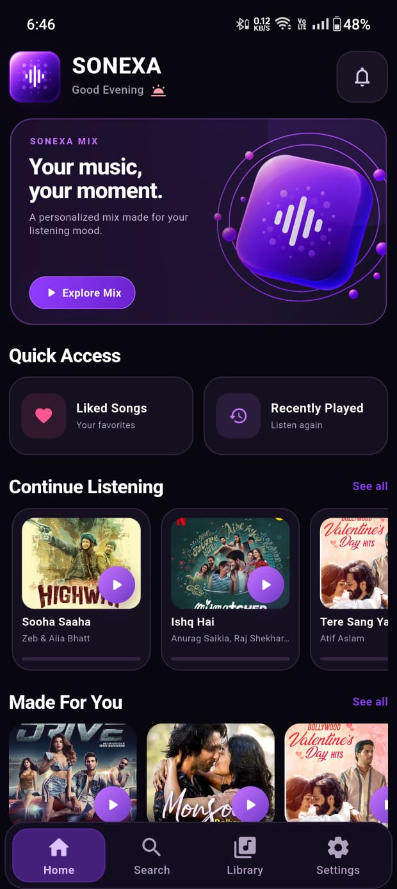
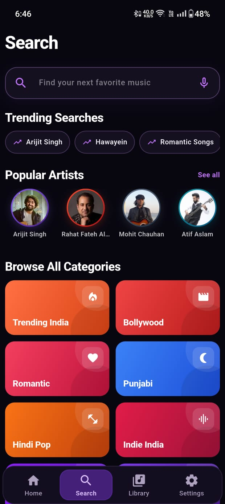
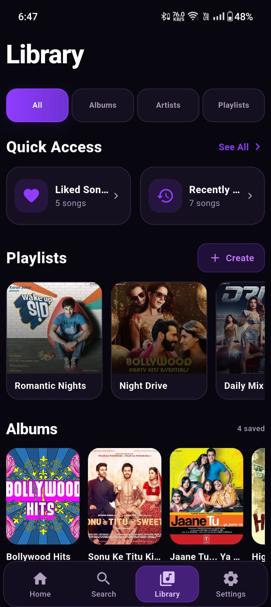
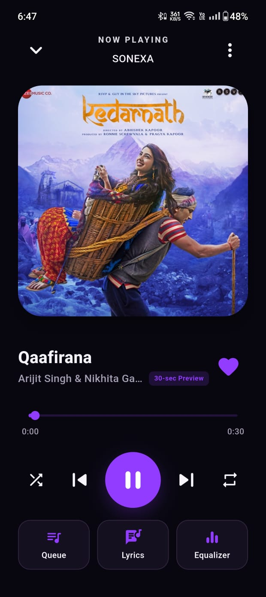
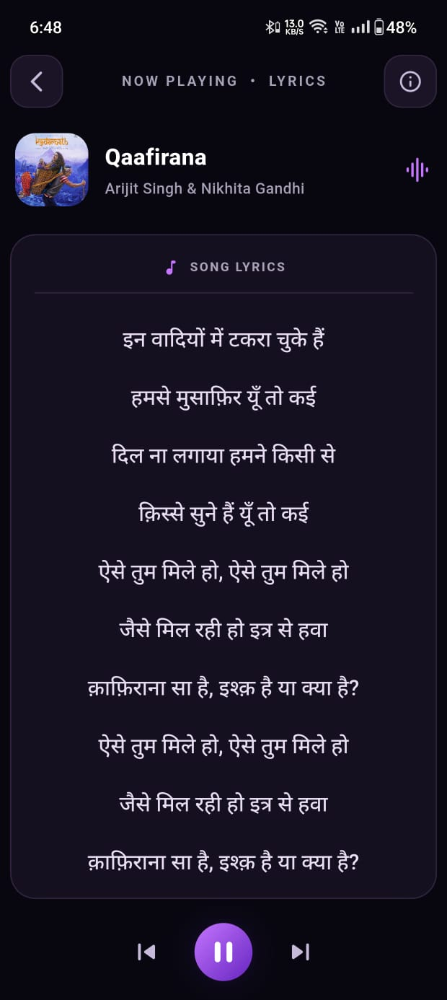
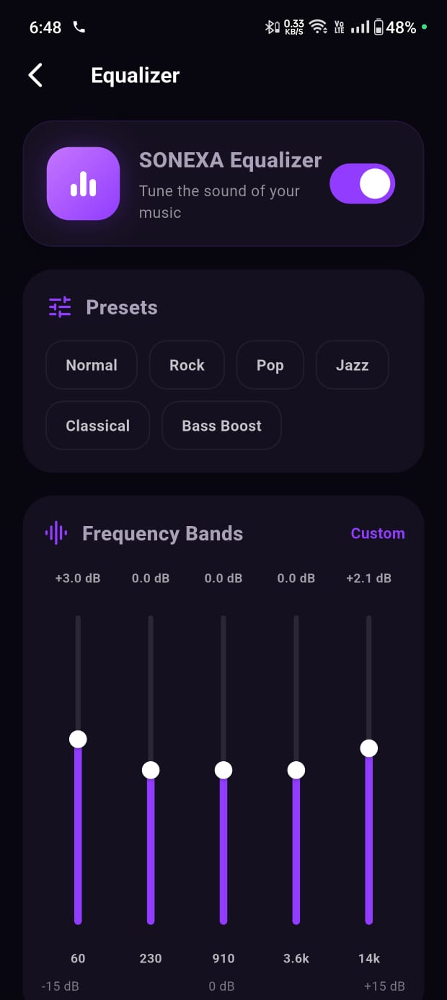
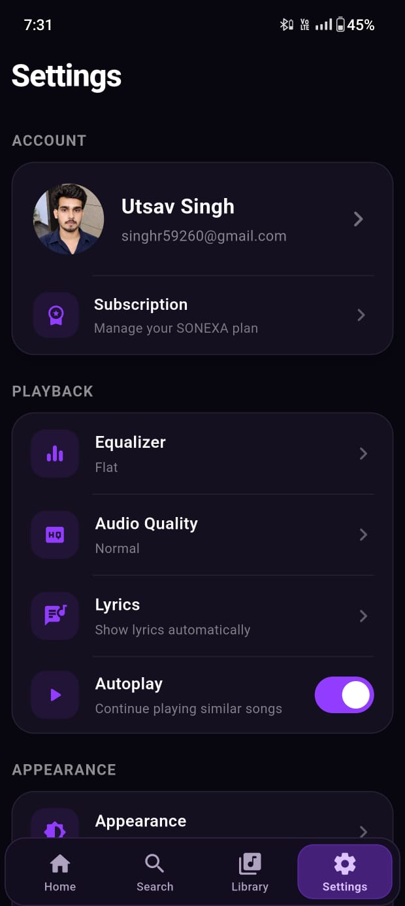

<div align="center">


# SONEXA

### Feel Every Beat 🎵

**A Flutter-powered Android music experience featuring music discovery, playback, personal collections, lyrics, queue controls, and customizable sound.**

[](https://flutter.dev/)
[](https://dart.dev/)


</div>

---

## About SONEXA

**SONEXA** is an Android music-player portfolio project developed using **Flutter and Dart**. It brings together a responsive interface, online music discovery, playback controls, saved music collections, lyrics lookup, an audio equalizer, and app settings.

The project demonstrates Flutter UI development, navigation, REST API integration, audio playback, local persistence, state management, and Android release builds.

## App Screenshots

<div align="center">

### Welcome & Authentication





*Splash • Login • Signup*

### Discover Your Music





*Home • Search • Library*

### Listening & Personalization






*Playback • Lyrics • Equalizer • Settings*

</div>

---

## Key Features

### Music Discovery

- Music discovery using iTunes, Jamendo, and Audius integrations
- Song, artist, and album search
- Home sections for discovery and listening
- Online artwork with fallback images
- Preview/full-track availability depending on the source

### Music Playback

- Play, pause, skip, seek, shuffle, and repeat controls
- Dedicated playback screen with album artwork and track details
- Persistent mini player
- Queue-based listening and track switching
- Audio equalizer with presets and adjustable frequency bands on supported Android devices

### Personal Library

- Liked Songs and Recently Played
- User-created playlists
- Saved albums and artists
- Library collections with persistent local preferences

### Lyrics & Customization

- Online lyrics lookup using LRCLIB with local lyric fallback
- Dark, Light, and System appearance modes
- Local settings persistence
- Audio quality preferences and optional biometric app lock on supported devices

## APIs & Services

| Service | Purpose |
|---|---|
| iTunes Search API | Music metadata, artwork, and preview discovery |
| Jamendo API | Music catalogue integration where available |
| Audius API | Additional online music discovery |
| LRCLIB | Online lyrics lookup |
| SharedPreferences | On-device preferences and collection storage |

> **Note:** Track availability, playback length, and artwork depend on the music provider. Selecting an audio-quality preference does not guarantee that a streaming provider will supply a different bitrate.

## Tech Stack

| Technology | Use |
|---|---|
| Flutter | Cross-platform UI framework (Android target) |
| Dart | Application logic |
| just_audio | Audio playback |
| audio_service | Audio-service integration |
| HTTP / REST APIs | Online catalogue and lyrics requests |
| SharedPreferences | Persistent local settings and data |
| Material Design | Theming, layout, and navigation |

## Project Structure

```text
SONEXA/
├── android/
├── assets/
│   └── images/
├── lib/
│   ├── data/
│   ├── models/
│   ├── navigation/
│   ├── player/
│   ├── screens/
│   ├── services/
│   ├── theme/
│   ├── widgets/
│   └── main.dart
├── screenshots/
│   ├── 01_splash.png
│   ├── 02_login.png
│   ├── 03_signup.png
│   ├── 04_home.png
│   ├── 05_search.png
│   ├── 06_library.png
│   ├── 07_playback.png
│   ├── 08_lyrics.png
│   ├── 09_equalizer.png
│   └── 10_settings.png
├── pubspec.yaml
└── README.md
```

## Getting Started

### Requirements

- Flutter SDK compatible with the project (developed with Flutter 3.47.1)
- Dart SDK compatible with the project (developed with Dart 3.13.1)
- Android SDK
- VS Code or Android Studio
- Android device or emulator

Check your setup:

```bash
flutter doctor
```

### Clone & Run

```bash
git clone https://github.com/utsavsingh1920/SONEXA.git
cd SONEXA
flutter pub get
flutter run
```

### Local Audio & API Setup

The public repository may not include copyrighted demonstration audio. For local playback, use audio that you have permission to distribute, place it in the required project asset paths, and update the relevant references in `pubspec.yaml` and the local song catalogue if needed.

Online features require an internet connection; API credentials or configuration may be needed for some providers. Never commit private keys or credentials to the repository.

## Android Release Build

Generate an ARM64 APK for modern Android phones:

```bash
flutter build apk --release --target-platform android-arm64
```

Output:

```text
build/app/outputs/flutter-apk/app-release.apk
```

Or generate architecture-specific APKs:

```bash
flutter build apk --release --split-per-abi
```

The **arm64-v8a** output is suitable for devices such as the OnePlus 11R. APK size depends on bundled audio, images, other assets, and dependencies.

## Current Status & Limitations

- **Version:** 1.0.0
- An Android release APK has been built successfully
- Some features depend on third-party APIs and device capabilities
- Lyrics timing synchronization depends on whether synchronized lyrics and playback timing data are available
- The prototype uses on-device storage for some account, library, and feedback flows; it is not a production authentication or cloud-sync system
- Music rights and provider terms must be checked before distributing an APK containing media

## Future Improvements

- Licensed or royalty-free music for publicly distributable builds
- Better background playback and media controls
- Offline caching where permitted
- Automated widget and integration tests
- Further APK size optimization

## Developer

**Utsav Singh**  
B.Sc. Information Technology Graduate  
Flutter Developer

GitHub: [@utsavsingh1920](https://github.com/utsavsingh1920)

## Disclaimer

SONEXA is an educational and portfolio project. Third-party music, artwork, names, and trademarks belong to their respective owners. SONEXA is not affiliated with or endorsed by music platforms or record labels mentioned above.

---

<div align="center">

**Made with Flutter and 💜 by Utsav Singh**

© 2026 Utsav Singh

</div>
