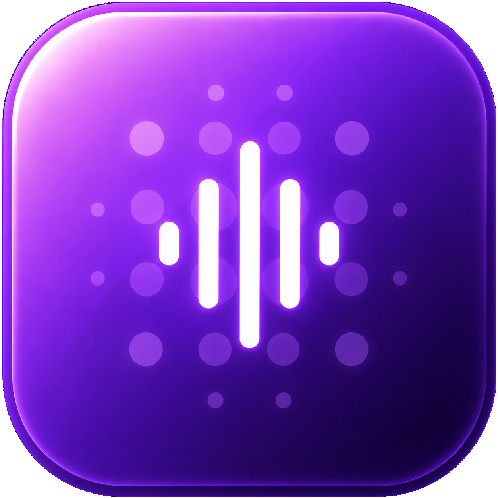

# 🎵 SONEXA — Feel Every Beat

<div align="center">



### Your Music, Your World 🎧

A Flutter-powered Android music experience featuring music discovery, playback, personal collections, lyrics, queue controls, and customizable sound.

[](https://flutter.dev/)
[](https://dart.dev/)


</div>

---

## About SONEXA

**SONEXA** is an Android music-player portfolio project developed using **Flutter and Dart**.

It brings together a responsive interface, online music discovery, playback controls, saved music collections, lyrics lookup, audio equalizer, and customizable app settings.

The project demonstrates Flutter UI development, navigation, REST API integration, audio playback, local persistence, state management, and Android release builds.

## App Screenshots

<div align="center">

### Welcome & Authentication


*Splash • Login • Signup*

### Discover Your Music


*Home • Search • Library*

### Listening & Personalization


*Playback • Lyrics • Equalizer • Settings*

</div>

> Add your actual screenshots to the `screenshots/` folder using the filenames shown above.

---

## Key Features

### Music Discovery
- Music discovery through iTunes, Jamendo, and Audius integrations.
- Song, artist, and album search.
- Home sections for music discovery and listening.
- Online artwork with fallback images.
- Preview and full-track availability depending on the provider.

### Music Playback
- Play, pause, skip, seek, shuffle, and repeat controls.
- Dedicated playback screen with album artwork and track details.
- Persistent mini player.
- Queue-based listening and track switching.
- Audio equalizer with presets and adjustable frequency bands on supported Android devices.

### Personal Library
- Liked Songs and Recently Played.
- User-created playlists.
- Saved albums and artists.
- Local persistence for supported library data.

### Lyrics & Customization
- Online lyrics lookup using LRCLIB with local lyric fallback.
- Dark, Light, and System appearance modes.
- Local settings persistence.
- Audio quality preferences.
- Optional biometric app lock on supported devices.

### Offline Playback
- 10 bundled local songs available for offline playback.
- Network artwork caching where supported.
- API-based music availability depends on the provider and connectivity.

---

## APIs & Services

| Service | Purpose |
|---|---|
| iTunes Search API | Music metadata, artwork, and preview discovery |
| Jamendo API | Music catalogue integration where available |
| Audius API | Additional online music discovery |
| LRCLIB | Online lyrics lookup |
| SharedPreferences | On-device preferences and collection storage |

> **Note:** Track availability, playback length, download permissions, and artwork depend on the respective music provider. Selecting an audio-quality preference does not guarantee that a streaming provider will supply a different bitrate.

## Tech Stack

| Technology | Usage |
|---|---|
| Flutter | Android UI development |
| Dart | Application logic |
| Riverpod | State management |
| just_audio | Audio playback |
| audio_service | Background audio integration |
| HTTP / REST APIs | Online catalogue and lyrics requests |
| SharedPreferences | Persistent local settings and data |
| cached_network_image | Network image caching |
| Material Design | Theming, layout, and navigation |

## Project Structure

```text
SONEXA/
├── android/
├── assets/
│   └── assets/
│       ├── audio/
│       └── images/
├── lib/
│   ├── core/
│   ├── data/
│   ├── models/
│   ├── navigation/
│   ├── player/
│   ├── screens/
│   ├── services/
│   ├── theme/
│   ├── widgets/
│   └── main.dart
├── pubspec.yaml
├── pubspec.lock
└── README.md
```

## Getting Started

### Requirements

- Flutter SDK compatible with the project.
- Dart SDK compatible with the project.
- Android SDK.
- VS Code or Android Studio.
- Android device or emulator.

Check your development environment:

```bash
flutter doctor
```

### Clone & Run

```bash
git clone https://github.com/utsavsingh1920/SONEXA.git

cd SONEXA

flutter pub get

flutter run
```

### Local Audio & API Setup

For local playback, use audio files that you have permission to distribute and place them in the required asset paths.

Update `pubspec.yaml` and the local song catalogue if asset paths change.

Online music discovery and streaming require an internet connection. Some provider features may also require API configuration.

Never commit private API keys, credentials, or signing passwords to the repository.

## Android Release Build

Generate an ARM64 APK for modern Android phones:

```bash
flutter build apk --release --target-platform android-arm64
```

Generate architecture-specific APKs:

```bash
flutter build apk --release --split-per-abi
```

Output directory:

```text
build/app/outputs/flutter-apk/
```

APK size depends on bundled audio, images, other assets, and dependencies.

## Project Validation

The current project has successfully passed:

- `flutter analyze`
- `flutter test`

## Current Status & Limitations

- **Version:** 1.0.0
- Android release APK successfully built.
- Some features depend on third-party APIs and device capabilities.
- Lyrics synchronization depends on the availability of synchronized lyrics and playback timing data.
- Some account, library, and feedback flows use on-device storage; this is not a production authentication or cloud-sync system.
- Offline API audio availability is subject to provider permissions and successful local caching.
- Music rights and provider terms must be checked before distributing an APK containing media.

## Future Improvements

- Licensed or royalty-free music for publicly distributable builds.
- Further improvements to background playback and media controls.
- Improved offline caching where permitted.
- Automated widget and integration tests.
- Further APK size optimization.

## Developer

**Utsav Singh**

B.Sc. Information Technology Graduate  
Flutter Developer

GitHub: [@utsavsingh1920](https://github.com/utsavsingh1920)

## Disclaimer

SONEXA is an educational and portfolio project. Third-party music, artwork, names, and trademarks belong to their respective owners.

SONEXA is not affiliated with or endorsed by the music platforms or record labels mentioned above.

---

<div align="center">

**Made with Flutter and 💜 by Utsav Singh**

© 2026 Utsav Singh

</div>